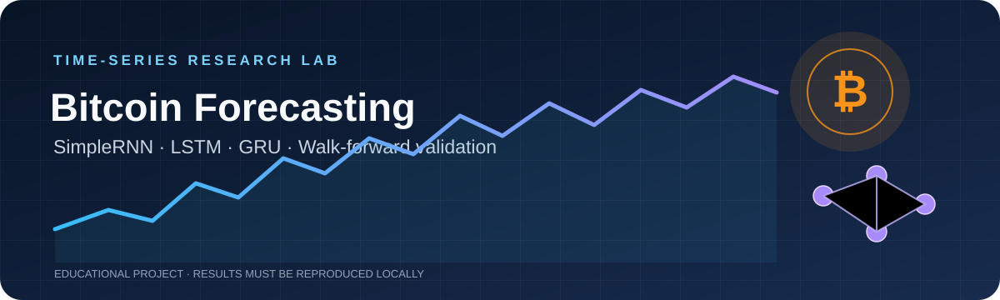
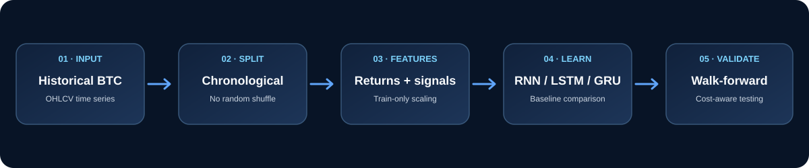

<div align="center">



# Bitcoin Time-Series Forecasting
### SimpleRNN · LSTM · GRU · Multivariate Features · Walk-Forward Validation

[](https://colab.research.google.com/github/Ozgurisikdamar/Bitcoin-Timeseries-RNN-LSTM-GRU/blob/main/bitcoin-timeseries-rnn-lstm-gru.ipynb)
[](https://www.python.org/)
[](https://www.tensorflow.org/)
[](https://jupyter.org/)
[](#project-status)

**A step-by-step investigation into recurrent neural networks for Bitcoin time-series forecasting — with baselines, careful time alignment, and evaluation that goes beyond a single error score.**

[Explore the notebook](bitcoin-timeseries-rnn-lstm-gru.ipynb) · [Dataset](https://www.kaggle.com/datasets/mczielinski/bitcoin-historical-data) · [Open in Google Colab](https://colab.research.google.com/github/Ozgurisikdamar/Bitcoin-Timeseries-RNN-LSTM-GRU/blob/main/bitcoin-timeseries-rnn-lstm-gru.ipynb)

</div>

> **Research project, not financial advice.** No profitability claim is made. Results depend on the data, environment, model configuration, and execution assumptions; rerun the notebook to reproduce metrics and charts.

---

## The research journey

The notebook follows a deliberate progression: start with a simple reference point, test recurrent architectures, change the target representation, add features, and then make the evaluation more demanding.



## Why this project?

A low prediction error alone does not prove that a model learned a useful signal — and it certainly does not prove a trading strategy is profitable. This project explores the questions in order:

- Can recurrent neural networks improve on simple forecasting baselines?
- Does modelling log returns tell a different story from modelling price levels?
- Do multivariate features help on the same evaluation timestamps?
- Do results persist across multiple chronological test windows?
- What changes when transaction costs and execution assumptions are considered?

## Notebook roadmap

| Stage | What happens | Why it matters |
|---|---|---|
| **01–04 · Data & problem setup** | Environment, data download, hourly OHLCV preparation, chronological split and lookback windows | Establishes a consistent forecasting problem without random time-series shuffling |
| **05 · Baseline** | Last-observed-price reference forecast | Gives neural networks a meaningful benchmark to beat |
| **06–07 · Recurrent models** | SimpleRNN, LSTM and GRU training and comparison | Tests model families against the baseline |
| **08–09 · Log returns** | Predict log returns and map predictions back to price/time | Examines an alternative target representation and alignment |
| **10–11 · Multivariate GRU** | Add engineered signals and evaluate on shared test timestamps | Tests whether extra inputs add measurable value |
| **12 · Backtesting** | Simulated signals, portfolio metrics and trading assumptions | Separates forecast quality from strategy outcomes |
| **13 · Walk-forward & quality gates** | Rolling chronological evaluation, stronger baselines and consistency checks | Tests whether conclusions depend on one particular split |

Each major stage includes a transition note explaining what was learned, what remains uncertain, and why the next experiment follows.

## Quick start

### Option A — Google Colab (recommended)

1. Click the **Open in Colab** badge at the top.
2. Run the notebook from the first cell in order.
3. Follow the data-loading cell instructions. If KaggleHub authentication is unavailable, use the notebook's documented CSV upload alternative.
4. Re-run the notebook to generate current outputs; saved output cells are intentionally not treated as authoritative results.

### Option B — Run locally

Python 3.10 or 3.11 is recommended. From a terminal in the repository:

```bash
python -m venv .venv
```

Activate the environment:

```bash
# Windows PowerShell
.venv\\Scripts\\Activate.ps1

# Windows Git Bash
source .venv/Scripts/activate

# Linux / macOS
source .venv/bin/activate
```

Install dependencies and launch Jupyter:

```bash
python -m pip install --upgrade pip
pip install -r requirements.txt
jupyter notebook
```

> The notebook was designed with Google Colab in mind and may use Colab-specific paths. If running locally, check the data path and Kaggle access instructions in the relevant cells.

## Data source

Default dataset: [Bitcoin Historical Data on Kaggle](https://www.kaggle.com/datasets/mczielinski/bitcoin-historical-data) (<code>mczielinski/bitcoin-historical-data</code>).

Dataset versions and coverage may change over time. Do not commit API tokens, Kaggle credentials, or private data to this repository. If using a compatible CSV, check that its timestamp and price columns match the notebook's expected schema.

## Evaluation principles

- **Chronological integrity:** training data must precede validation/test data.
- **Train-only preprocessing:** fit scalers on the relevant training segment, not on future observations.
- **Comparable test points:** compare models on matching timestamps and target definitions.
- **Baselines first:** a complex model is useful only if it adds value over simpler alternatives.
- **Walk-forward evaluation:** repeat testing across successive time windows rather than trusting one split.
- **Trading realism:** fees, slippage, signal timing, position changes and benchmark choice can materially change backtest outcomes.
- **Honest reporting:** figures and metrics should come from a real notebook run; illustrative diagrams are conceptual, not experimental results.

## Technology stack

<div align="center">

| Data & analysis | Deep learning | Experiment interface |
|:---:|:---:|:---:|
| pandas · NumPy | TensorFlow · Keras | Jupyter Notebook |
| scikit-learn | SimpleRNN · LSTM · GRU | Google Colab |
| Matplotlib | Feature engineering | KaggleHub |

</div>

## Repository contents

- <code>bitcoin-timeseries-rnn-lstm-gru.ipynb</code> — main notebook with Turkish explanations and experiments.
- <code>assets/bitcoin-forecasting-banner.svg</code> — project header artwork.
- <code>assets/research-pipeline.svg</code> — conceptual overview of the research flow.
- <code>requirements.txt</code> — Python dependencies.
- <code>.gitignore</code> — excludes local/generated files that should not be versioned.

## Project status & limitations

This is an educational research workflow, not a production trading system. The included validation checks are a starting point, not proof of statistical significance, live-market robustness, or future profitability. Model performance can vary with the data version, random seed, library versions, and market regime.

Potential next experiments:

- repeat training with multiple random seeds and report variability;
- extend walk-forward folds and compare more statistical baselines;
- run feature ablations to measure each engineered input's contribution;
- test sensitivity to transaction costs and slippage;
- analyse errors by market regime;
- record dataset versions and experiment configurations for reproducibility.

## License

No license is currently specified. Until a license is added, standard copyright applies; reuse permissions are not implied.
